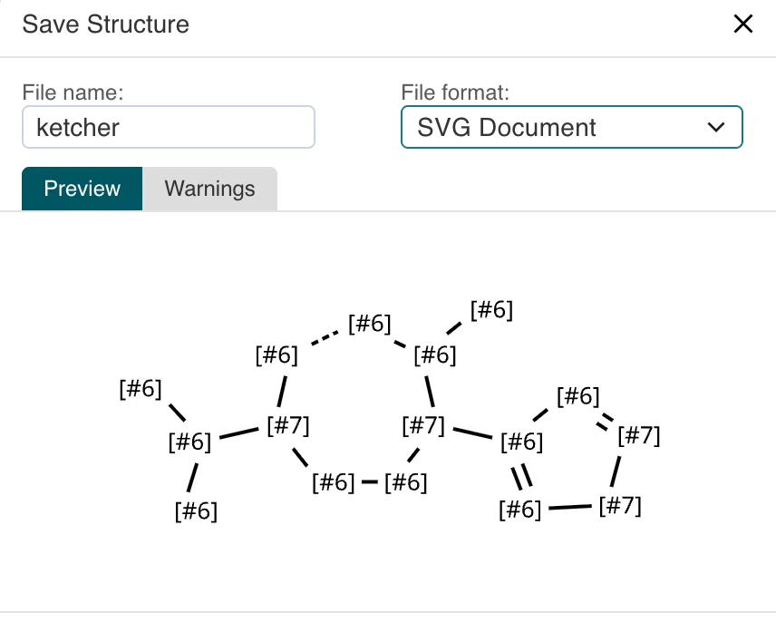

# Бэклог

Живой список улучшений Ketcher Desktop. Одна задача = зачем, что сейчас, план, критерии готовности.

Статусы: `идея` → `в работе` → `готово`. Приоритет: высокий / средний / низкий.

---

## 1. WYSIWYG-экспорт картинки: звёздочки и any-связи превращаются в SMARTS, алиасы пропадают

**Статус:** идея · **Приоритет:** высокий · **Область:** `ketcher` (upstream-проблема)

### Симптом

При экспорте картинки (Save Structure → SVG/PNG) структура с «звёздочкой» (`*`, any atom) или
связью типа any рендерится как SMARTS: вместо `C`/`N` — `[#6]`/`[#7]`, вместо алиасов на атомах — ничего.
Сам холст Ketcher при этом показывает нормальную картинку. То есть экспорт **не WYSIWYG**.

### Как воспроизвести

1. Нарисовать структуру (например, бензол с заместителем).
2. Поставить атом `*` и/или связь типа any; повесить на атом алиас (Edit Atom → Alias).
3. Save Structure → формат `SVG Document` → Preview.
4. Ожидание: картинка как на холсте. Факт: SMARTS-подписи `[#6]`, `[#7]`, алиасы отсутствуют.

### Где копать

- Путь экспорта: [`Save/Save.tsx`](ketcher/packages/ketcher-react/src/script/ui/views/modal/components/document/Save/Save.tsx#L609) —
  `options.outputFormat = imageFormat`, дальше `generateImage` через struct service
  (в standalone-режиме — Indigo WASM, [`formatProperties.ts`](ketcher/packages/ketcher-core/src/application/formatters/formatProperties.ts#L196)).
- **Гипотеза:** Ketcher-холст рисует своим рендерером (`packages/ketcher-core/src/application/render`),
  а картинку на экспорт отдаёт Indigo, который для query-структуры печатает SMARTS-метки и не знает про `atom.alias`.
- Что проверить в первую очередь:
  1. Опции `GenerateImageOptions` / Indigo render: нет ли режима «рисовать как молекулу» или опции показа алиасов.
  2. Как Indigo получает структуру (KET/SMILES?) — возможно, теряется на этапе сериализации, а не рендера.
  3. Альтернативный путь: отдавать SVG из собственного рендерера Ketcher (у него уже есть SVG-сцена), а PNG — растеризовать её.
  4. Сравнить: экспорт в KET → переоткрытие показывает алиасы? Если да — проблема в рендере, а не в модели.

### Решение по оформлению

Правка идёт **PR в апстрим** (`epam/ketcher`), если получится разобраться в причине.
Значит делаем «как для чужого репозитория», а не как локальный хак:

- Отдельная ветка от свежего `master` (сейчас `ketcher/` стоит на локальной
  `feature/copy-as-smiles`, а `origin` смотрит прямо на `epam/ketcher` — форка-ремоута ещё нет).
- Сначала issue: PR-шаблон требует привязку к issue и имя вида `#1234 – issue name`.
  Шаблон бага лежит в [`ISSUE_TEMPLATE/bug_report.md`](ketcher/.github/ISSUE_TEMPLATE/bug_report.md),
  к нему и приложить скриншот из этой задачи.
- Unit-тест: рядом уже есть [`Save.test.tsx`](ketcher/packages/ketcher-react/src/script/ui/views/modal/components/document/Save/Save.test.tsx) — класть туда.
- Пройти чек-лист шаблона PR ([`pull_request_template.md`](ketcher/.github/pull_request_template.md)):
  unit-тесты, e2e-тесты, документация, имя ветки без `#`.
- Минимальный диф: если причина в одной опции Indigo — не переписывать экспорт целиком.

### Критерии готовности

- [ ] Сохранённый SVG визуально совпадает с холстом: `*` — звёздочкой, any-связь — как на холсте, алиасы на месте
- [ ] PNG получается из того же результата (не отдельной веткой кода)
- [ ] Обычные (не-query) структуры экспортируются как раньше — регрессии нет
- [ ] Unit-тест в `Save.test.tsx` (или там, где окажется причина) покрывает query-структуру с алиасом
- [ ] Если Indigo в принципе не умеет — это выяснено и записано в issue, а не замаскировано костылём

---

## Сделано

- **Copy Selection as SMILES** — меню `Structure → Copy Selection as SMILES`,
  хоткей `Cmd+Shift+S`. Копирует выделение как Daylight SMILES через Indigo,
  пишет в буфер из main-процесса. Проверено: `CCO` → в буфере `CCO`,
  при пустом выделении буфер не меняется. Код: [main/commands/copy-smiles.js](main/commands/copy-smiles.js).
  Пока без визуальной обратной связи при пустом выделении (только лог) —
  если окажется неочевидным, добавить уведомление.
- **Модульная структура main-процесса.** `main.js` — только инициализация;
  окно, протокол, меню и команды разложены в [main/](main). Правило для новых фич:
  новый файл в `main/commands/` + пункт меню в `main/menu.js`.
- **Своё меню приложения** с акселераторами и стандартными ролями
  (Edit/View/Window), чтобы `Cmd+C`/`Cmd+V` продолжали работать в полях ввода.
- **Офлайн-режим без dev-сервера.** Ketcher и Indigo (WASM) собираются в бандл
  (`renderer/dist`) и отдаются приложению через собственный протокол `app://`.
  Проверено: `setMolecule('c1ccccc1O')` → `getSmiles()` возвращает `c1c(O)cccc1`
  без сети. Подробности — в [README.md](README.md#как-устроено).
- **Нативный `.app`: имя, иконка, Launchpad.** `npm run dist` собирает
  `Ketcher Desktop.app` (bundle id `com.moleculadesigner.ketcherdesktop`,
  иконка из [build/icon.svg](build/icon.svg)) и `.dmg`. Установлено в `/Applications`
  и запускается через LaunchServices.

## Идеи без приоритета

- Открытие/сохранение `.ket`/`.mol`/`.sdf` через `preload` + IPC.
- Подпись и нотаризация, если приложение когда-нибудь пойдёт «в люди».
