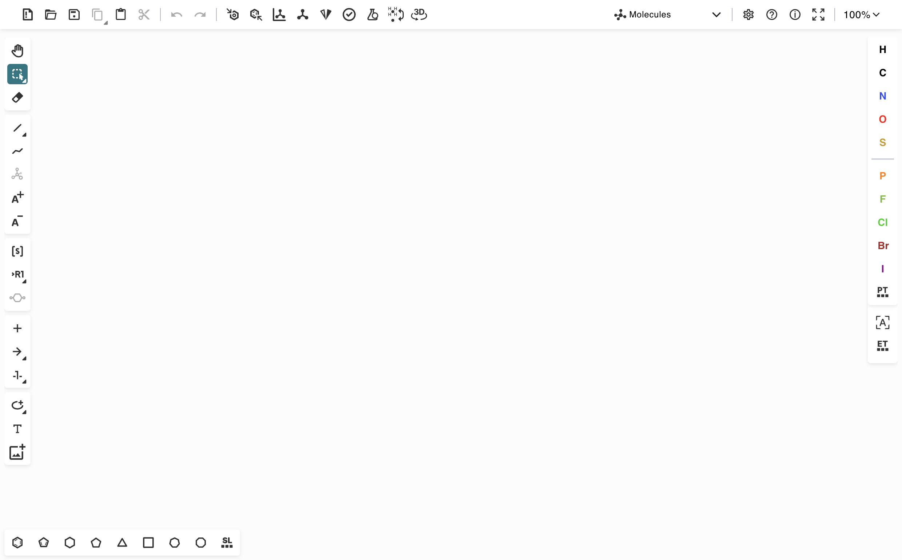

# Ketcher Desktop

Нативная macOS-обёртка для [Ketcher](https://github.com/epam/ketcher) — химического редактора структур.
Обычное приложение: своя иконка в Dock и Launchpad, своё имя, без адресной строки и вкладок.
**Работает офлайн, без локального сервера** — Ketcher и Indigo (WASM) лежат внутри приложения.



Текущие задачи и идеи — в [BACKLOG.md](BACKLOG.md).

## Как устроено

```
┌────────────────────────────── app://bundle ──────────────────────────────┐
│  renderer/  — наша веб-часть (React + ketcher-react из npm)              │
│  Vite собирает её в renderer/dist → внутрь .app (asar)                   │
└──────────────────────────────────────────────────────────────────────────┘
                    ▲                                    
                    │ протокол app:// (main.js)
┌───────────────────┴──────────────────────────────────────────────────────┐
│  main.js — главный процесс Electron: окно, меню, файлы, свой протокол    │
└──────────────────────────────────────────────────────────────────────────┘
```

Два процесса, как в любом Electron-приложении:

- **main** (`main.js`, Node.js) — создаёт окно, отдаёт статику из `renderer/dist`
  через собственный протокол `app://`, а в будущем будет открывать/сохранять файлы.
- **renderer** (React + Chromium) — рисует интерфейс Ketcher.

Зачем протокол `app://`, а не `file://`? Браузер запрещает загружать ES-модули и
Web Worker'ы с `file://` (считает их «чужим происхождением»). `app://bundle/...`
выглядит для Chromium как обычный сайт — и модули, и Worker с WASM работают штатно.
Регистрация — в начале [main.js](main.js), обработчик — `registerAppProtocol()`.

## Быстрый старт

```sh
npm install          # один раз
npm start            # соберёт renderer и откроет приложение
```

Сборки занимают ~2 секунды, `prestart` запускает её автоматически, так что
`npm start` всегда запускает актуальную версию.

## Команды

| Команда | Что делает |
| --- | --- |
| `npm start` | собрать веб-часть и открыть приложение |
| `npm run build:renderer` | только собрать бандл в `renderer/dist` |
| `npm run dev:renderer` | dev-сервер нашей веб-части с hot reload (порт 5190) |
| `npm run dist` | собрать `.app` + `.dmg` + `.zip` в `release/` |
| `npm run install:app` | собрать и поставить в `/Applications`, убрав дубль из `release/` |
| `npm run ketcher:dev` | dev-сервер Ketcher из локального клона `ketcher/` |
| `npm run icon` | пересобрать `build/icon.png` из `build/icon.svg` (нужен Inkscape) |

## Два режима работы

**1. Обычный запуск (по умолчанию).** Ketcher берётся из npm-пакетов
`ketcher-react` / `ketcher-standalone` и уже вшит в приложение. Сеть и сервер не нужны.

**2. Разработка самого Ketcher.** Если в `ketcher/` вы правите исходники апстрима,
запустите его dev-сервер и укажите на него Electron:

```sh
# терминал 1
npm run ketcher:dev

# терминал 2
KETCHER_URL=http://127.0.0.1:5173/ npm start
```

В этом режиме Electron открывает dev-сервер вместо встроенного бандла — работает
hot reload. Переменными `KETCHER_URL` и `KETCHER_DEVTOOLS=1` удобно пользоваться
и при отладке нашей веб-части через `npm run dev:renderer`.

> **Важно:** пакеты в npm отстают от master. Сейчас в npm `3.18.0`,
> а в локальном клоне `ketcher/` — `3.20.0`. Если нужна свежая версия Ketcher,
> это повод перейти на режим 2 (или собрать пакеты локально).

## Сборка приложения

```sh
npm run dist
```

Результат в `release/`:

- `mac-arm64/Ketcher Desktop.app` — само приложение;
- `Ketcher Desktop-0.1.0-arm64.dmg` — установщик (перетащить в Applications);
- `Ketcher Desktop-0.1.0-arm64-mac.zip` — для обновлений/раздачи.

Установка «как обычное приложение» — одной командой:

```sh
npm run install:app
```

Она собирает бандл, копирует `.app` в `/Applications` через `ditto`
(сохраняет права и xattr), регистрирует его в Launch Services и **удаляет
промежуточную копию** `release/mac-arm64/`. Иконка после этого есть в Dock и Launchpad.

Почему удалять копию обязательно: Spotlight (а значит и Raycast/Alfred, и поиск
в Launchpad) индексирует **любой** `.app` на диске, не только в `/Applications`.
Если оставить `release/mac-arm64/Ketcher Desktop.app`, в поиске будет две
одинаковые программы. Маркер `.metadata_never_index` в этом случае не помогает —
проверено, пересобранный `.app` всё равно попадает в индекс. `.dmg` и `.zip`
в `release/` остаются: они не бандлы приложений и в поиске не мешают.

Если всё же собрали через `npm run dist` и видите дубль — удалите папку
`release/mac-arm64/` (или переустановите через `npm run install:app`).

Сборка **не подписана** (`mac.identity: null` в [package.json](package.json)):
для личного использования этого достаточно. Для раздачи другим людям нужен
Apple Developer ID и нотаризация, иначе Gatekeeper будет ругаться.

## CI и релизы

Два workflow в [.github/workflows](.github/workflows):

| Файл | Когда | Что делает |
| --- | --- | --- |
| [ci.yml](.github/workflows/ci.yml) | каждый PR и пуш в `main` | `npm ci` + сборка веб-части: проверяет, что проект вообще собирается |
| [release.yml](.github/workflows/release.yml) | пуш тега `v*` | собирает `.dmg` и `.zip` на macOS-раннере и создаёт GitHub Release с этими файлами |

### Как выпустить версию

```sh
npm version 0.2.0 --no-git-tag-version   # поднять версию в package.json
npm run install:app                      # опционально: проверить локально
git add package.json package-lock.json
git commit -m "release: 0.2.0"
git push
git tag v0.2.0
git push origin v0.2.0                   # ← это запускает release.yml
```

Дальше само: раннер ставит зависимости, собирает приложение, заливает
`.dmg` и `.zip` в Releases страницы репозитория.

**Текст релиза писать руками не нужно.** Шаг «Текст релиза» собирает его из
`git log`: заголовок `## Что изменилось с vX.Y.Z` и список коммитов от
предыдущего тега до текущего. Дальше идёт статичная инструкция по установке.
Готовый текст видно в логе шага до публикации, а после — можно отредактировать
прямо на GitHub (Releases → карандаш), если хочется переформулировать.

Важные детали workflow:

- **Тег должен совпадать с версией** в `package.json`, иначе job падает на первом шаге —
  чтобы в релизе `v0.2.0` не оказался бандл версии `0.1.0`.
- `checkout` идёт с `fetch-depth: 0`: для списка изменений нужны теги и история,
  а по умолчанию GitHub отдаёт только один коммит.
- Сборка идёт на `macos-15` (Apple Silicon, `--arm64`). Для Intel-сборки нужен
  раннер `macos-13` и флаг `--x64`; для универсальной — `--universal`.
- Кэш `~/Library/Caches/electron*` ставится **до** `npm ci`, а сам `npm ci` идёт с
  `ELECTRON_SKIP_BINARY_DOWNLOAD=1`: бинарник Electron для npm не нужен,
  electron-builder качает свой экземпляр для упаковки.
- Кнопка **Run workflow** в Actions собирает `.dmg` без публикации релиза —
  удобно проверять изменения, не трогая теги. Файл лежит в артефактах запуска.
- Шаг сборки **повторяется до трёх раз**. electron-builder лениво докачивает свои
  бинарники (7zip, dmgbuild) с GitHub Releases, и тот периодически отдаёт
  `504 Gateway Time-out`: dmg уже собран, а job падает. Повтор застаёт скачанное
  в кэше, поэтому вторая попытка занимает секунды. Первый релиз `v0.2.0` упал
  именно на этом.
- Сборка не подписана, поэтому в тело релиза автоматически подставляется
  инструкция про `xattr -dr com.apple.quarantine` — иначе у скачавших
  macOS скажет «приложение повреждено».

> Workflow должен быть в том коммите, на который ставится тег. Поэтому файлы
> `.github/workflows/*` коммитим и пушим **до** `git tag`.

### Почему CI не нужен `ketcher/`

Папка `ketcher/` — локальный клон апстрима, она в `.gitignore`. CI собирает
приложение из npm-пакетов `ketcher-react` / `ketcher-standalone`, так что
локальная разработка форка и релизная сборка друг от друга не зависят.

### Иконка

Цепочка такая:

```
build/icon.svg  ──npm run icon──▶  build/icon.png  ──npm run dist──▶  .app/Contents/Resources/icon.icns
   (исходник)                      (1024×1024)                        (набор 16…1024 для Retina)
```

- [build/icon.svg](build/icon.svg) — исходник, его и правим.
- [build/icon.png](build/icon.png) — растр, который делает `npm run icon`
  ([scripts/make-icon.mjs](scripts/make-icon.mjs)).
- `icon.icns` electron-builder собирает сам: в [package.json](package.json) поле
  `build.mac.icon` указывает на PNG, а `build.directories.buildResources` — на папку `build/`.
  В `.app` прописывается `CFBundleIconFile = icon.icns` в `Info.plist`.

**Рендерит Inkscape, а не resvg.** В иконке используются mesh-градиенты (SVG 2,
теги `<meshgradient>` / `<meshpatch>`), которые resvg не поддерживает — он молча
пропускает их, и получается почти пустая картинка. Inkscape же понимает mesh
нативно. Скрипт ищет его в `PATH`, `/opt/homebrew/bin`, `/Applications/Inkscape.app`
(или берёт путь из `INKSCAPE=...`), а если не нашёл — падает обратно на resvg
и предупреждает, что градиенты потеряются.

Порядок замены иконки: правим SVG → `npm run icon` → `npm run install:app`.
PNG можно нарисовать и сразу в 1024×1024 (тогда шаг `npm run icon` не нужен),
но SVG удобнее: одна правка — и все размеры пересобраны.

> Иконка нарисована в Inkscape. Раньше в SVG ехал `<script id="mesh_polyfill">` —
> полифил, который дорисовывал mesh-градиенты в браузерах (в Firefox и Chrome
> иконка была видна именно благодаря ему). В файле иконки скрипт не нужен:
> Inkscape понимает mesh нативно, скрипты не выполняет, а в ассете это лишний
> исполняемый код. Удалён.

## Структура

```
ketcher-desktop/
├── main.js                 # главный процесс: окно, протокол app://, меню
├── error.html              # подсказка, если приложение не смогло загрузиться
├── renderer/               # наша веб-часть
│   ├── index.html
│   ├── vite.config.js      # сборка в renderer/dist
│   └── src/main.jsx        # React: <Editor> из ketcher-react + standalone Indigo
├── build/icon.svg|png      # иконка приложения
├── ketcher/                # локальный клон апстрима (только для режима разработки)
├── release/                # результат npm run dist (в git не попадает)
└── docs/                   # скриншоты
```

## Как это работает внутри (для тех, кто учит JS/Node)

- `require('electron')` — аналог `import` в Python. Из модуля достаём `app`
  (жизненный цикл), `BrowserWindow` (окно), `protocol` (свои схемы URL).
- `app.whenReady().then(...)` — аналог `await` для события «Electron готов»:
  окна можно создавать только после него.
- `protocol.handle('app', ...)` — мы сами решаем, что отдать на `app://bundle/...`.
  Читаем файл из `renderer/dist` и возвращаем `Response` с правильным `Content-Type`
  (без него Chromium не выполнит `.js` как модуль).
- `webPreferences: { nodeIntegration: false, contextIsolation: true, sandbox: true }` —
  страница не имеет доступа к Node.js. Это правильный дефолт; когда понадобятся
  файловые диалоги, общение пойдёт через `preload.js` + IPC, а не напрямую.
- В `renderer/src/main.jsx` мы кладём экземпляр Ketcher в `window.ketcher` —
  так до его API сможет дотянуться главный процесс (например, для хоткея
  «скопировать выделение как SMILES» из бэклога).

### Две неочевидные правки в сборке

Обе — в [renderer/vite.config.js](renderer/vite.config.js), обе нужны именно
из-за Ketcher:

- `resolve.alias.events` — Ketcher использует Node-модуль `events` (`EventEmitter`).
  В браузере его нет, и Vite подставляет заглушку, на которой приложение падает
  с `EventEmitter is not a constructor`. Поэтому подключён браузерный полифил
  из пакета `events`.
- `define.global` — часть кода Ketcher рассчитывает на Node-глобал `global`.
  Апстримный пример для этого вставляет `var global = global || window`;
  здесь то же самое делается на этапе сборки.

## Траблшутинг

- **Пустое окно / окно с подсказкой** — запустите `KETCHER_DEVTOOLS=1 npm start`
  и посмотрите консоль. Если был задан `KETCHER_URL`, проверьте, что сервер жив.
- **`Emoji ... is not a constructor` / `global is not defined`** — кто-то удалил
  шимы из `renderer/vite.config.js`; верните их.
- **Порт 5173 занят** — Vite возьмёт 5174 и напишет это в консоли;
  тогда `KETCHER_URL=http://127.0.0.1:5174/ npm start`.
- **Приложение не появляется в Launchpad** — проверьте, что `.app` лежит
  в `/Applications`, и обновите базу Launch Services:
  `/System/Library/Frameworks/CoreServices.framework/Frameworks/LaunchServices.framework/Support/lsregister -f "/Applications/Ketcher Desktop.app"`.

## Что дальше

- Хоткей «копировать выделение как SMILES» на уровне Electron (см. бэклог).
- Открытие/сохранение `.ket`/`.mol`/`.sdf` через `preload.js` + IPC.
- Своё меню приложения вместо стандартного.
